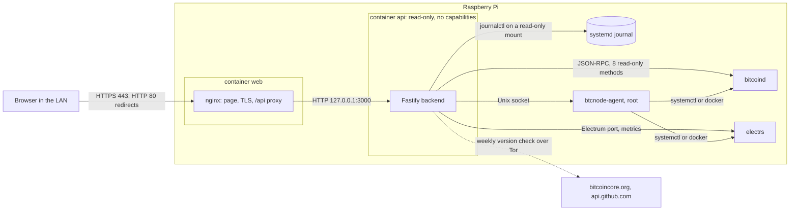

# Architecture

Two containers on the Pi's host network and one small service on the host.
The browser only ever talks to nginx.

| Part | Runs as | Can reach |
|---|---|---|
| `web` (`deploy/`) | nginx master as root, 4 capabilities, read-only | the api on 127.0.0.1 |
| `api` (`backend/`) | uid 1000, read-only, no capabilities | RPC, electrs, the agent socket; journal, unit files and data directory read-only |
| `btcnode-agent` (`agent/`) | root, systemd unit on the host | systemctl and docker for the fixed roles |

The api polls the node, judges the state against `shared/src/thresholds.ts`
and serves one validated snapshot (`shared/src/status.ts`). The page renders
it. Control actions need a login and go api, agent, systemctl.

Images are built by CI, signed with cosign and deployed by digest
([ADR 0001](docs/adr/0001-signed-images-by-digest.md)). Further decisions
are in [`docs/adr/`](docs/adr/), the threat model in
[`docs/threat-model.md`](docs/threat-model.md).
